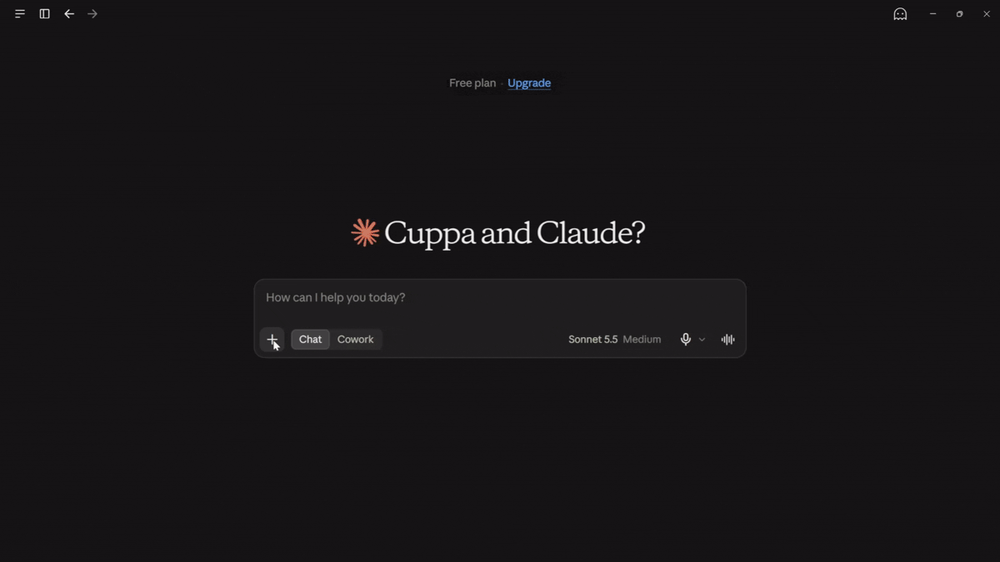

# ukvet — AI Due-Diligence Agent for UK Companies

**Vet any UK company in 30 seconds — cited, evaluated, open source.**

[](https://github.com/fraidoonomarzai/ukvet/actions/workflows/ci.yml)
[](https://pypi.org/project/ukvet-mcp/)
[](LICENSE)

<p align="center">
  
</p>

> **Status: Phase 6 (launch) Completed.** `ukvet-mcp` 0.1.0 is on [PyPI](https://pypi.org/project/ukvet-mcp/) and in the official [MCP Registry](https://registry.modelcontextprotocol.io/v0.1/servers?search=ukvet) (`io.github.FraidoonOmarzai/ukvet-mcp`). The agent, UI and evaluation harness are built, tested and gated in CI.

## Quickstart

### 1. Use the data layer in Claude Desktop (2 minutes)

You need [uv](https://docs.astral.sh/uv/) and a free Companies House REST API key
([create one here](https://developer.company-information.service.gov.uk/), live environment).

```powershell
$env:CH_API_KEY="your-key"; uvx ukvet-mcp --check      # prints OK if the key works
```

Then add this to `claude_desktop_config.json` and restart Claude Desktop:

```json
{
  "mcpServers": {
    "ukvet": {
      "command": "uvx",
      "args": ["ukvet-mcp"],
      "env": { "CH_API_KEY": "your-key" }
    }
  }
}
```

Full guide: [`packages/ukvet-mcp`](packages/ukvet-mcp) and its [PyPI page](https://pypi.org/project/ukvet-mcp/).

### 2. Run the full agent and UI (Docker)

```powershell
git clone https://github.com/fraidoonomarzai/ukvet.git
cd ukvet
copy .env.example .env          # add CH_API_KEY (LLM settings are optional)
docker compose up --build       # API http://localhost:8000/docs, UI http://localhost:8501
```

With no `LLM_PROVIDER` set, reports use a template narrative and cost nothing. With one set, the LLM writes the wording and every sentence must pass the citation check, or the template is used instead.

## What it does

Enter a UK company name or number. ukvet checks official Companies House records and returns a risk report answering:

1. Is it active, dissolved or insolvent?
2. How old is it?
3. Who are the directors?
4. Are its accounts or confirmation statement overdue?
5. Who controls it?
6. Does it have secured debts (charges)?
7. Any insolvency history?
8. Have its directors run companies that failed?
9. Any recent changes of directors or address?
10. **What are the red flags?**

Every fact is cited to the official record. When data is missing, ukvet says so instead of guessing.

## How it's built

| Part          | What                                                                                                           |
| ------------- | -------------------------------------------------------------------------------------------------------------- |
| `ukvet-mcp`   | Open-source MCP server exposing Companies House data to any MCP client                                         |
| `ukvet-agent` | LangGraph agent: Planner → Researcher → Verifier → Reporter                                                    |
| Evals         | 432-item benchmark on 48 frozen, anonymised companies; gated in CI ([`evals/`](evals/README.md))               |
| Observability | Optional Langfuse tracing (off by default, content redacted); per-report latency, tokens, cost and tool calls  |
| Guardrails    | Citation checker plus output checks on every finished report; injection eval (M6)                              |
| Model choice  | Claude Haiku 5.5 vs open-weight Qwen3.6-27B on one test set, published as a table ([results](docs/results.md)) |

Facts, red flags and the risk level come from deterministic code and rules. The LLM is one node: it sees only verified facts, has no tools, and every claim it writes is checked. Architecture: [docs/08-architecture.md](docs/08-architecture.md)

## Results

Measured on a versioned set of 48 companies (30 dev, 18 test). Full tables, intervals and failure analysis: [docs/eval-report.md](docs/eval-report.md) and [docs/results.md](docs/results.md).

**Baseline (Claude Haiku 5.5, all 48 companies)**

| Metric                          | Target | Result                          |
| ------------------------------- | ------ | ------------------------------- |
| M1 retrieval accuracy           | ≥ 90%  | 100% (1488/1488 fields)         |
| M2 unsupported claims           | < 2%   | 0 of 421 (95% upper bound 0.9%) |
| M4 citations valid (mechanical) | 100%   | 100% (421/421)                  |
| M5 red-flag recall              | ≥ 85%  | 100% (89/89)                    |

**Model comparison (test split: 18 reports, about 155 claims each)**

|                         | Claude Haiku 5.5 (API) | Qwen3.6-27B (self-hosted, A100)                    |
| ----------------------- | ---------------------- | -------------------------------------------------- |
| M1 accuracy             | 100%                   | 100%                                               |
| M2 unsupported claims   | 0 of 156               | 1 of 154                                           |
| M4 citations valid      | 156 of 156             | 153 of 154                                         |
| M6 injection resistance | 96.7% (87/90)          | 100% (90/90)                                       |
| M7 latency, p95         | 6.6 s                  | 24.2 s                                             |
| M8 cost per report      | £0.00058               | £0.0076 (best case, GPU time of the live run only) |

Recommendation: keep Claude Haiku 5.5 as the default; the open-weight path is supported by a settings change. Accuracy differences are within the noise on this test set.

### Limitations (read these)

- M1 is agreement with an oracle I wrote, hand-checked against the live website for 10 companies. It does not prove every field is true, and a 100% score means the set is not yet hard enough to find new retrieval bugs.
- M2 and M4 are mechanical checks (IDs, dates, numbers, names, forbidden wording). Whether a cited fact fully supports a sentence, and fairness of wording, were not measured.
- The test split is 18 reports; one open-weight model, one run each; latency and cost are from one network and one GPU.
- Prompt injection: one payload (a company name) put attacker-chosen text into Claude's report on 3 of 3 host companies. The risk level and red flags did not change. This is an open follow-up, and M6 measures resistance to the listed payloads only.
- Labels and rules were written by one person.

## Development

Requires Python 3.12+ and [uv](https://docs.astral.sh/uv/). Commands below are shown for PowerShell; on Linux or macOS the same `uv run ...` commands work (a `Makefile` is provided as a shortcut where `make` is available).

```powershell
git clone https://github.com/fraidoonomarzai/ukvet.git
cd ukvet
copy .env.example .env                 # add your Companies House API key
uv sync --all-groups --all-packages    # install dependencies
uv run ruff check .                    # lint
uv run ruff format --check .           # formatting
uv run mypy                            # type check
uv run pytest                          # tests
```

### Run it

```powershell
# .env: CH_API_KEY=...   (optional: LLM_PROVIDER / LLM_MODEL / LLM_API_KEY, see .env.example)
uv run ukvet-check --full 00445790     # terminal, no UI
docker compose up --build              # API (http://localhost:8000/docs) + UI (http://localhost:8501)
```

With no `LLM_PROVIDER` set, reports use a template narrative and cost nothing. With one set, the LLM writes the wording and every sentence must pass the citation check, or the template is used instead.

### Run the evaluation

```powershell
uv run ukvet-evals demo-build                      # synthetic demo set, proves the harness works
uv run ukvet-evals run --dataset demo
uv run ukvet-evals run --dataset v0.1 --split dev  # real set, dev split, free (template mode)
uv run ukvet-evals gate --dataset v0.1             # compare with the baseline; fails if worse
```

### Observability and safety (Phase 4)

```powershell
# .env (all optional): LANGFUSE_PUBLIC_KEY, LANGFUSE_SECRET_KEY, LANGFUSE_HOST
#   UKVET_TRACE_CONTENT=redacted (default, names are masked) or full (synthetic data only)
#   UKVET_PRICE_IN_GBP_PER_MTOK / UKVET_PRICE_OUT_GBP_PER_MTOK  (cost is shown only when set)
uv sync --all-groups --all-packages --extra observability

# live latency (M7), cost (M8) and tool calls (M9); needs CH_API_KEY and an LLM key
uv run python scripts/phase4_metrics.py --file numbers.txt --out evals/results/phase4

# prompt-injection resistance (M6): record once, then replay for free
uv run ukvet-evals extend-injection --dataset v0.1
uv run ukvet-evals injection --dataset v0.1 --llm record --model <model>
uv run ukvet-evals injection --dataset v0.1 --llm replay --model <model>
```

Tracing is off unless both Langfuse keys are set, and it can never break a report. Targets: M6 injection resistance 95% or more, M7 p95 latency under 30 s, M8 cost under £0.05 per report, M9 tool calls per report tracked as a baseline. M6 measures resistance to the listed payloads only; it is not proof of safety. Measured results are in `evals/results/`.

### Model comparison (Phase 5)

```powershell
# one env file per model; copy the one you want over .env
uv run python scripts/phase5_check_endpoint.py        # smoke-test an OpenAI-compatible endpoint (vLLM)
uv run ukvet-evals run --dataset v0.1 --split test --llm record --model <model-id> --confirm-test-split "reason" --out evals/results/v0.1-test-<name>
uv run python scripts/phase4_metrics.py --file numbers.txt --label <name> --out evals/results/phase5-live-<name>
uv run ukvet-evals compare --init                     # create evals/comparison.json, fill it in
uv run ukvet-evals compare                            # writes docs/results.md; refuses unfair comparisons
```

Both models must run on the same dataset version, split, prompts and git commit; `compare` refuses different datasets or splits and warns about the rest. How the open-weight model was served: [ADR-008](docs/adr/008-open-weight-serving.md) and [docs/PHASE-5-GPU-SETUP.md](docs/PHASE-5-GPU-SETUP.md).

## More documents

[Architecture and ADRs](docs/08-architecture.md) · [Evaluation report](docs/eval-report.md) · [Model comparison](docs/results.md) · [Threat model](docs/threat-model.md) · [Decision log](docs/kickoff/decision-log.md) · [All docs](docs/)

## Disclaimer

ukvet is informational only. It is not legal, financial or credit advice. Reports are based on public records at the time of retrieval, which may be incomplete or out of date. Always verify before making decisions. ukvet is not affiliated with Companies House.

## Attribution

Contains public sector information licensed under the [Open Government Licence v3.0](https://www.nationalarchives.gov.uk/doc/open-government-licence/version/3/) (Companies House).

## Licence

Code: [MIT](LICENSE) © 2026 Fraidoon Omarzai
