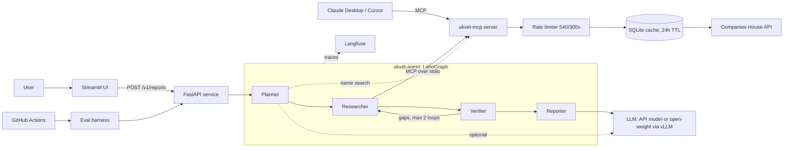
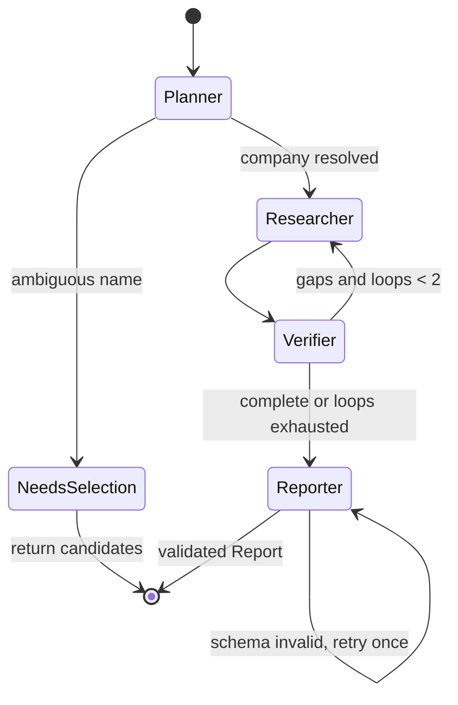

# System Design: ukvet

| Field       | Value                                                                                                      |
| ----------- | ---------------------------------------------------------------------------------------------------------- |
| Version     | 0.1 (Proposed)                                                                                             |
| Owner       | Fraidoon Omarzai                                                                                           |
| Date        | 16 Oct 2026                                                                                                |
| Built today | Data layer only: `ukvet-mcp` (Phase 1). Everything else here is **design**, to be confirmed in Phases 2-5. |

---

## 1. Requirements

### Functional

| ID  | Requirement                                                                                             |
| --- | ------------------------------------------------------------------------------------------------------- |
| F1  | Input: a UK company name or number. A name may be ambiguous: return candidates and let the user choose. |
| F2  | Output: a structured report answering Q1-Q10, with a citation for every factual claim.                  |
| F3  | When data is missing, say "insufficient data" instead of guessing.                                      |
| F4  | Expose the same data as an MCP server usable from Claude Desktop, Cursor and other clients.             |
| F5  | Every report carries the disclaimer and OGL attribution.                                                |

### Non-functional (targets from `04-success-metrics.md`)

| Area        | Target                                                                             |
| ----------- | ---------------------------------------------------------------------------------- |
| Accuracy    | >= 90% factual accuracy, < 2% hallucinated claims, 100% valid citations            |
| Latency     | p95 < 30 s per report                                                              |
| Cost        | < GBP 0.05 per report                                                              |
| Reliability | Survives Companies House 429s, 5xx and timeouts without crashing or inventing data |
| Privacy     | No person search, no long-term storage of personal data, minimal fields            |
| Security    | Untrusted registry text cannot steer the agent; API key never leaks                |
| Quality     | >= 80% test coverage; evals gate every merge                                       |

### Out of scope

See `03-scope.md` (credit scores, advice, non-UK companies, accounts PDFs, user accounts).

---

## 2. Capacity and constraints (from the Phase 0 spike)

| Fact                 | Value                                           | Consequence                                                  |
| -------------------- | ----------------------------------------------- | ------------------------------------------------------------ |
| Rate limit           | 600 requests / 5 min per API key; we cap at 540 | **~1.8 requests/s is the hard ceiling for the whole system** |
| API calls per report | median 7, max 11                                | ~77 reports / 5 min (~15/min) sustained                      |
| API latency          | median 38 ms, p95 189 ms                        | API time is negligible (< 1 s even with Q8)                  |
| Repeat checks        | cache TTL 24 h                                  | A cached company costs **0** API calls                       |

**What this tells us:**

1. **The bottleneck is the shared rate limit, not CPU or memory.** One process on one small machine is enough. Scaling out does not raise throughput, because all replicas share one API key.
2. **LLM time dominates latency**, so the < 30 s target is really about the LLM design (section 5).
3. The cache is a throughput feature, not just a speed-up.

Back-of-envelope: a demo or portfolio workload is a handful of reports per minute, about 10x below the ceiling. Design for correctness first and scale later.

---

## 3. High-level architecture



Three layers with hard boundaries:

| Layer     | Component           | Owns                                                                                 | Never does                       |
| --------- | ------------------- | ------------------------------------------------------------------------------------ | -------------------------------- |
| Data      | `ukvet-mcp`         | Auth, rate limit, retries, cache, "no data" semantics, minimisation, citable sources | Reasoning, LLM calls             |
| Reasoning | `ukvet-agent`       | Planning, verification, report writing                                               | Talk to Companies House directly |
| Interface | FastAPI + Streamlit | Validation, timeouts, display                                                        | Business logic                   |

---

## 4. Components in detail

### 4.1 Data layer: `ukvet-mcp` (built)

Eight tools returning `{found, data, source, notes}`. Key behaviours: sliding-window limiter, retries with backoff, pagination caps, ambiguous-404 resolution, computed fields (`age_days`, `status_counts`, charge counts). See `10-phase-1-guide.md`.

### 4.2 Agent graph: `ukvet-agent` (design)



**State** (one typed object flows through the graph):

```python
class AgentState(TypedDict):
    request: str  # raw user input
    company_number: str | None
    candidates: list[SearchHit]  # when the name is ambiguous
    plan: list[str]  # which of Q1..Q9 to answer
    facts: list[Fact]  # each tagged with question_id + source
    gaps: list[str]  # facts we could not obtain
    loops: int
    report: Report | None
```

| Node           | Responsibility                                                                                                                                                                                                           | Uses LLM?                                                             |
| -------------- | ------------------------------------------------------------------------------------------------------------------------------------------------------------------------------------------------------------------------ | --------------------------------------------------------------------- |
| **Planner**    | Number given: skip straight to the plan. Name given: `search_company`; one clear match proceeds, several return candidates. Free-text question ("who controls X?"): pick the relevant subset of Q1-Q9.                   | Only for free-text questions; **no LLM** for a number or a plain name |
| **Researcher** | Execute the plan: fan out profile, officers, PSC, charges, insolvency and filings **in parallel**, then Q8 appointments for current directors (capped). Convert every tool result into tagged `Fact`s.                   | **No**: deterministic code over MCP tools                             |
| **Verifier**   | Deterministic checks: every planned question has a fact or an explicit gap; profile flags agree with detail endpoints (`has_charges` vs charges); flag contradictions. Gaps trigger one targeted re-fetch (max 2 loops). | **No**                                                                |
| **Reporter**   | One structured-output call: write findings, red flags and an assessment **only from verified facts**, each claim referencing fact IDs. Validate with Pydantic; one retry on failure.                                     | **Yes**: 1 call (2 on retry)                                          |

**Design decision (propose as ADR-007):** keep the LLM out of Researcher and Verifier. The ten questions are fixed, so tool calls need no LLM judgement; code is faster, cheaper and cannot hallucinate a tool argument. Trade-off: less "agentic" for the standard report. The agentic parts are the Planner's handling of free-text questions and the Verifier's loop. This is what makes < GBP 0.05 and < 30 s realistic, and what makes accuracy evals meaningful (retrieval correctness is separable from writing quality).

### 4.3 Citation enforcement (the core quality mechanism)

The Reporter outputs claims shaped as `{text, fact_ids[]}`. A **deterministic post-check** then:

1. rejects any `fact_id` that does not exist,
2. for dates, counts and statuses, checks the claim text contains the value of the cited fact,
3. strips or flags any claim with no citation.

This check is what produces metrics M2 (hallucination) and M4 (citation validity). Reports that fail it are retried once, then returned with the failing claims removed and `missing_data` noted.

### 4.4 Interface

**FastAPI**

| Endpoint                                                  | Behaviour                                                                                                                                                                                        |
| --------------------------------------------------------- | ------------------------------------------------------------------------------------------------------------------------------------------------------------------------------------------------ |
| `POST /v1/reports` `{ "company": "00445790" or "tesco" }` | `200` Report; `200` with `status: "needs_selection"` and candidates; `404` unknown number; `422` invalid input; `429` our own per-client limit; `503` Companies House unavailable; `504` timeout |
| `GET /health`                                             | Liveness, plus a cheap check that the MCP subprocess is up                                                                                                                                       |

Synchronous request/response is enough because the target is < 30 s. Add Server-Sent Events later for progress ("fetching officers...") if the wait feels long.

**Streamlit** shows candidates for selection, the report with clickable citations (`source.url`), the freshness timestamp, the disclaimer and the attribution.

### 4.5 How the agent talks to the MCP server

**Proposal:** the API process starts `ukvet-mcp` as a long-lived stdio subprocess and keeps one client session. This is simplest and matches how Claude Desktop uses it.

| Option                              | Pros                                                         | Cons                                                                  |
| ----------------------------------- | ------------------------------------------------------------ | --------------------------------------------------------------------- |
| **stdio subprocess (proposed)**     | Zero networking, one rate limiter per process, simple Docker | One process owns the limiter, so you cannot run multiple API replicas |
| Streamable HTTP, separate container | Independent scaling, shared limiter if single instance       | More moving parts, needs auth between services                        |

Decide in Phase 2 (ADR-008). The stdio choice is fine until you need more than one API replica, which the rate limit makes unlikely anyway.

---

## 5. Latency and cost budget

| Stage                    | Expected                | Notes                                                  |
| ------------------------ | ----------------------- | ------------------------------------------------------ |
| Planner (number or name) | < 0.5 s                 | One search call at most; no LLM                        |
| Researcher               | ~0.5 s                  | 6 parallel calls (~0.2 s p95 each) then Q8 (1-5 calls) |
| Verifier                 | < 0.05 s                | Pure code                                              |
| Reporter                 | **3-15 s (unmeasured)** | Dominates; depends on model and output length          |
| Retry (rare)             | + Reporter time         | Only if schema or citation check fails                 |

**The honest status:** everything except the Reporter is measured or trivially small. The Reporter number is a guess until Phase 4 measures it. Levers if it is too slow or expensive: shorter output schema, smaller model for drafting, trimming facts passed to the prompt, caching reports for 24 h.

Cost per report is one LLM call of a few thousand tokens in and about a thousand out. Whether that is under GBP 0.05 depends on the model chosen; Langfuse will give the real figure (metric M8).

---

## 6. Data model

| Entity           | Lifetime                  | Stored where                                                    |
| ---------------- | ------------------------- | --------------------------------------------------------------- |
| API responses    | 24 h                      | SQLite cache (0600), purged on start                            |
| `Fact`, `Report` | Request only              | Returned to the client; **not persisted by default**            |
| Traces           | Retention set in Langfuse | Contain prompts, which may include director names: keep private |
| Eval dataset     | Permanent                 | Repo; company-level facts, anonymised names                     |
| Fixtures         | Permanent                 | Repo; synthetic or anonymised                                   |

Schemas for `Fact`, `Report` and `RedFlag` are in `08-architecture.md`. Rule: the Reporter may only reference facts that exist in `facts`.

---

## 7. Reliability and failure modes

| Failure                                              | Detection                            | Behaviour                                                                                          |
| ---------------------------------------------------- | ------------------------------------ | -------------------------------------------------------------------------------------------------- |
| Companies House 429                                  | HTTP 429 or low `X-Ratelimit-Remain` | Limiter pauses everyone; client retries with backoff; after 3 attempts, `503` with a clear message |
| Companies House 5xx or timeout                       | Status or exception                  | Retry (3 attempts), then `503`; never serve a partial report as complete                           |
| Partial data (one endpoint down)                     | Researcher records a gap             | Report states what is missing; `risk_level` may be `insufficient_data`                             |
| Ambiguous name                                       | Several search hits                  | Return candidates; never guess                                                                     |
| Company not found                                    | `CompanyNotFound`                    | `404` with guidance                                                                                |
| Dissolved or insolvent company                       | Profile status                       | Normal report; status is the headline red flag                                                     |
| Very large company (hundreds of officers or filings) | Truncation flag                      | Caps apply; report states it is partial                                                            |
| LLM returns invalid structure                        | Pydantic validation                  | One retry, then fail with an error, not a free-text answer                                         |
| LLM cites a non-existent fact                        | Citation post-check                  | Claim removed, counted against M2/M4                                                               |
| LLM provider outage or timeout                       | Exception, 30 s deadline             | `503`; consider a fallback model later                                                             |
| Prompt injection in company or officer names         | Evals (M6) and prompt design         | See section 8                                                                                      |
| MCP subprocess crashes                               | Health check, client error           | Restart it; fail the request cleanly                                                               |

Overall deadline: the API enforces a hard timeout (e.g. 45 s) so a request can never hang the UI.

---

## 8. Security and privacy

- **Untrusted text.** Company names, officer names and filing descriptions are attacker-controlled (anyone can register a company called "Ignore previous instructions"). Mitigations: (1) the Researcher is deterministic, so injected text cannot trigger tool calls; (2) only the Reporter sees registry text, in delimited data blocks with an instruction to treat it as data; (3) its output is schema-validated and citation-checked; (4) it has no tools, so even a successful injection can only corrupt wording, which the citation check then catches; (5) injection cases are in the eval set (M6).
- **Privacy.** No person search; fields minimised at the data layer; short-lived cache; reports not persisted; traces private; recorded fixtures anonymised with a leak check.
- **Secrets.** Key in environment variables, masked everywhere, scanned by Gitleaks in CI, never sent to the LLM.
- **Abuse.** Rate limit per client on the public API if you host a demo; no bulk export; respect the Companies House terms.
- **Harmful outputs.** The Reporter must not state or imply wrongdoing by individuals. The prompt and a deterministic check on phrasing enforce this ("was a director of 3 companies that were dissolved", never "serial failure").

Reviewed against `06-legal-and-ethics.md`; revisit if you host a public demo.

---

## 9. Observability and evaluation

| Concern           | Mechanism                                                                                                                                        |
| ----------------- | ------------------------------------------------------------------------------------------------------------------------------------------------ |
| Per-request trace | Langfuse: one trace per report, one span per node and tool call                                                                                  |
| Cost and latency  | Tokens, cost and p50/p95 per node, so you can see where time goes                                                                                |
| Quality           | Eval harness runs the question set through the API; rule-based scoring for M1-M5; LLM-as-judge only for report quality, hand-checked on a sample |
| Regression        | CI runs a fixture-based subset on every PR and blocks merges that drop M1, M2 or M4                                                              |
| Server health     | stderr logs from `ukvet-mcp` (see the logging discussion), request counts and 429s                                                               |

Because retrieval is deterministic, eval failures split cleanly: **retrieval errors** (tool or mapper bug) versus **writing errors** (Reporter hallucination). That separation is a strong point in the write-up.

---

## 10. Deployment

**Local and demo:** `docker-compose` with two services: `api` (FastAPI + agent + the MCP subprocess) and `ui` (Streamlit). A volume holds the SQLite cache. Secrets come from `.env`.

**Environments:**
| Env | Companies House | LLM |
|---|---|---|
| Test / CI | Recorded fixtures only, **no network** | Recorded or stubbed responses for the fast subset |
| Dev | Live, cached | API model |
| Eval runs | Live or cached, pinned dataset version | API model, then open-weight (Phase 5) |

**If you host a demo:** one small container, one API key, a per-IP rate limit, no stored reports. Do not build more infrastructure than this.

---

## 11. Scaling path (only if ever needed)

| Pressure                | First step                                                            | Later                                                               |
| ----------------------- | --------------------------------------------------------------------- | ------------------------------------------------------------------- |
| More concurrent reports | Async concurrency in one process (already designed)                   | Bounded worker pool                                                 |
| Rate limit exhausted    | Raise the cache hit rate (longer TTL for stable data); queue requests | Ask Companies House about higher limits, or use their bulk snapshot |
| Multiple replicas       | Move limiter and cache to Redis; HTTP MCP transport                   | Central rate-limit service                                          |
| Slow reports            | Stream progress; cheaper drafting model; cache reports                | Pre-compute popular companies                                       |
| Open-weight model       | vLLM behind an OpenAI-compatible endpoint (ADR-003)                   | Autoscale GPU workers                                               |

Do none of this before measuring. At portfolio scale, the single-process design is correct.

---

## 12. Trade-offs and rejected alternatives

| Decision     | Chosen                                | Rejected                          | Why                                                       |
| ------------ | ------------------------------------- | --------------------------------- | --------------------------------------------------------- |
| Data access  | MCP server                            | Direct API calls inside the agent | Reusable by other tools; testable without an LLM          |
| Researcher   | Deterministic code                    | LLM-driven ReAct loop             | Cheaper, faster, no argument hallucination, cleaner evals |
| Graph shape  | Fixed 4-node graph with a capped loop | Free-form single agent            | Control, testability, enforceable "only verified facts"   |
| Rate limiter | Sliding window                        | Token bucket                      | Cannot exceed the real limit (ADR-006)                    |
| Cache        | SQLite, 24 h                          | Redis                             | One process, no extra service (ADR-004)                   |
| Persistence  | None for reports                      | Store every report                | UK GDPR minimisation                                      |
| Transport    | stdio first                           | HTTP first                        | Simplest; revisit if replicas are needed                  |
| Sync API     | Request/response                      | Job queue                         | Target < 30 s does not justify queue complexity           |

---

## 13. Open questions (resolve in Phase 2-4)

1. Is the Reporter's latency inside the 30 s budget with the chosen model? (Measure in Phase 2.)
2. Cap for Q8: how many current directors per report? (Spike: median 1, max 5 calls; start at 5.)
3. Should free-text questions ("who controls X?") be in the MVP, or only the full report? (Affects Planner complexity.)
4. How should corporate PSCs be traced? One level only, as a gap note?
5. ADR-007 (deterministic Researcher) and ADR-008 (stdio vs HTTP): accept or revise after the prototype.

---

# Appendix: how to do system design

## The process

| Step                           | Question to answer                                                                           | Output                                 | In this project             |
| ------------------------------ | -------------------------------------------------------------------------------------------- | -------------------------------------- | --------------------------- |
| 1. Clarify the problem         | Who is it for and what pain does it fix?                                                     | Problem statement                      | `01`                        |
| 2. Requirements                | What must it do (functional)? How well (non-functional, with numbers)? What is out of scope? | Requirement lists with targets         | `02`, `03`, `04`            |
| 3. Constraints and estimates   | What limits exist (rate limits, budget, data)? Rough load, latency and cost?                 | Capacity table                         | `05`, section 2 above       |
| 4. High-level design           | What are the major components and the data flow?                                             | One diagram and a responsibility table | section 3                   |
| 5. Deep dive on the hard parts | Where is the real risk? Design that part in detail.                                          | Component designs                      | agent graph, citation check |
| 6. Data and interfaces         | What data exists, where does it live, how long? What are the API contracts?                  | Data model, API spec                   | sections 4.4, 6             |
| 7. Failure modes               | What breaks, how do we notice, what happens to the user?                                     | Failure table                          | section 7                   |
| 8. Security and privacy        | Who can attack or misuse it? What data is sensitive?                                         | Threat list and controls               | section 8, `06`             |
| 9. Observability and testing   | How will we know it works and that it keeps working?                                         | Metrics, tracing, evals, CI gates      | section 9                   |
| 10. Trade-offs and decisions   | What did we choose, and what did we reject and why?                                          | ADRs                                   | `08`, section 12            |
| 11. Scaling path               | What changes if load grows 10x or 100x?                                                      | Ordered list of next steps             | section 11                  |
| 12. Iterate                    | What did we learn? Update the design.                                                        | Revised doc, decision log              | `kickoff/decision-log.md`   |

## Rules of thumb

1. **Requirements with numbers first.** "Fast" is not a requirement; "p95 < 30 s" is.
2. **Find the bottleneck before designing.** Here it was the rate limit, which made scaling out pointless.
3. **Start simple, justify every extra box.** Each component must answer "what breaks if it is missing?"
4. **Put hard boundaries between layers.** Data, reasoning and interface changed independently.
5. **Design for failure, not just success.** The failure table prevents surprises.
6. **Write decisions down with alternatives** (ADRs). A design without rejected options reads as a guess.
7. **Separate what is built and measured from what is proposed and guessed.** Say so in the document.
8. **Make quality measurable from the start.** Evals are part of the design, not a late add-on.
9. **Prototype the riskiest part early.** Here: the Reporter's latency and citation compliance.
10. **Keep the document alive.** Update it when the spike or a prototype contradicts it.

## For interviews

Walk through in this order: problem, requirements with numbers, estimates, high-level diagram, the hardest component in depth, failure modes, trade-offs, scaling. Spend most of the time on step 5 and step 7. Say what you measured versus what you assumed; interviewers trust candidates who do.

## Common mistakes

- Drawing boxes before stating requirements.
- Designing for scale you will never see.
- Hiding trade-offs, or presenting one option as the only option.
- Ignoring failure and abuse cases.
- No plan for how you will know the system is correct.
- Letting the document go stale after the first prototype.
